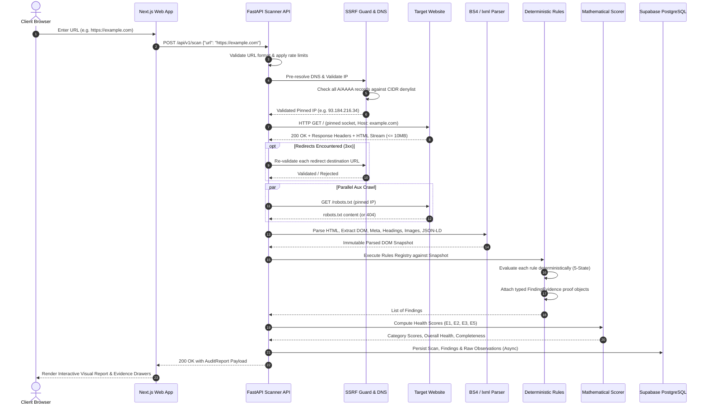

# SEO Optimizer — System Architecture Document

> **Version**: 2.0.0 (Foundation Alignment)  
> **Status**: Approved Architectural Baseline  
> **Backend Architecture**: Python 3.x | FastAPI | Pydantic v2 | httpx | BeautifulSoup4 + lxml  
> **Frontend Architecture**: Next.js (App Router) | React | TypeScript | Tailwind CSS  
> **Persistence**: Supabase PostgreSQL (RLS, Alembic Migrations, AES-256-GCM Token Encryption)

---

## 1. System Overview

SEO Optimizer is an enterprise-grade, deterministic Technical SEO Diagnosis, Competitor Intelligence, and Code Resolution Platform. The architecture is organized as a decoupled application repository composed of a responsive client application (`apps/web`), a single primary high-performance analytical backend (`apps/api`), isolated asynchronous workers, and a secure relational persistence tier.

### High-Level Architectural Diagram

```mermaid
flowchart TD
    subgraph ClientLayer ["Client & Ingress Layer"]
        User["End User / Client Browser"]
        Admin["Technical SEO Engineer / Admin"]
        CDN["Edge CDN / Cloudflare"]
        NextApp["Next.js Web Application\n(App Router / TypeScript / Tailwind)"]
    end

    subgraph APILayer ["API & Control Plane (Python / FastAPI)"]
        FastAPI["FastAPI Application Server\n(apps/api/app/main.py)"]
        RateLimiter["In-Memory / Token Bucket Limiter"]
        SSRFGuard["SSRF & DNS Validation Guard\n(Socket Pinning & CIDR Denylist)"]
    end

    subgraph EngineLayer ["Core Deterministic Engine (Python)"]
        Crawler["Static HTTP Crawler\n(httpx / Manual Redirect Interception)"]
        Parser["HTML & DOM Parser\n(BeautifulSoup 4 + lxml / RFC 8259 JSON-LD)"]
        RuleEngine["Deterministic Rules Engine\n(5-State Evaluator & Structured Evidence)"]
        Scorer["Mathematical Scoring Module\n(E1-E36 Deterministic Models)"]
    end

    subgraph SandboxedWorkers ["Sandboxed Asynchronous Workers"]
        PlaywrightWorker["Isolated Headless Browser Worker\n(Later Phase: Containerized SPA Render)"]
        SandboxRemediator["Secure Code Remediation Sandbox\n(Phase 5: Ephemeral MicroVM / AST Diff)"]
    end

    subgraph DataLayer ["Data & Persistence Layer"]
        Supabase["Supabase PostgreSQL\n(RLS, Alembic Migrations, Scans, Leads)"]
        ObjectStorage["Encrypted Object Storage\n(Quarantined Client ZIPs & Code Patches)"]
    end

    subgraph ExternalServices ["External Integrations (Explicit Consent & Quotas)"]
        PSI["Google PageSpeed Insights API\n(CrUX Field 75th pctl vs PSI Lab)"]
        GSC["Google Search Console API\n(OAuth 2.0 / AES-256-GCM Encrypted)"]
        SERP["Compliant SERP Provider API\n(Licensed Competitor Ranks)"]
    end

    User -->|HTTPS| CDN
    Admin -->|HTTPS| CDN
    CDN --> NextApp
    NextApp -->|Versioned REST API Calls\nGenerated TypeScript Client| FastAPI

    FastAPI --> RateLimiter
    RateLimiter --> SSRFGuard
    SSRFGuard -->|Sanitized Transport & Pinned IP| Crawler
    Crawler --> Parser
    Parser --> RuleEngine
    RuleEngine --> Scorer
    Scorer --> FastAPI

    FastAPI -.->|Async Queue (Deferred)| PlaywrightWorker
    FastAPI -.->|Isolated MicroVM Job| SandboxRemediator

    FastAPI --> Supabase
    SandboxRemediator --> ObjectStorage
    Supabase --> ObjectStorage

    FastAPI -.->|Explicit User Trigger| PSI
    FastAPI -.->|Authenticated Trigger| GSC
    FastAPI -.->|Scoped Request| SERP
```

---

## 2. Repository Folder Structure

The repository is organized into distinct application boundaries. The backend is implemented as a cohesive, modular Python application under `apps/api`, while TypeScript is used exclusively for the frontend under `apps/web`. No secondary Node.js backend exists.

```
seo-optimizer/
├── apps/
│   ├── web/                         # Next.js App Router (TypeScript frontend)
│   │   ├── src/
│   │   │   ├── app/                 # Next.js App Router pages and layouts
│   │   │   │   ├── (public)/        # Landing page, instant scan, public report
│   │   │   │   ├── (admin)/         # Admin Resolution Center & lead management
│   │   │   │   └── api/             # Frontend route proxies (if required)
│   │   │   ├── components/          # Reusable UI components (Tailwind CSS)
│   │   │   │   ├── audit/           # Audit cards, 5-state badges, evidence modals
│   │   │   │   ├── common/          # Layout, buttons, inputs, navigation
│   │   │   │   └── resolution/      # Diff viewer, patch approvals, runbook views
│   │   │   ├── features/            # Feature-specific client state and hooks
│   │   │   └── lib/
│   │   │       ├── api/
│   │   │       │   └── generated/   # Auto-generated TypeScript client from FastAPI OpenAPI
│   │   │       └── utils/           # Client-side presentation helpers
│   │   ├── package.json             # Frontend dependencies (pnpm)
│   │   ├── tsconfig.json
│   │   └── tailwind.config.ts
│   │
│   └── api/                         # Single primary backend (Python + FastAPI)
│       ├── pyproject.toml           # Python project specification (uv managed)
│       ├── uv.lock                  # Pinned dependency lockfile
│       ├── app/
│       │   ├── main.py              # FastAPI application initialization & middleware
│       │   ├── api/
│       │   │   └── v1/
│       │   │       ├── api.py       # API router aggregator
│       │   │       └── endpoints/   # /scan, /leads, /health, /competitors, /resolution
│       │   ├── core/                # Settings (pydantic-settings), security, logging, errors
│       │   ├── contracts/           # Pydantic v2 canonical DTOs & response schemas
│       │   ├── crawler/             # Safe HTTP fetcher, DNS resolution, socket pinning
│       │   ├── parsers/             # BeautifulSoup4, lxml, headers, robots, sitemaps, JSON-LD
│       │   ├── rules/               # 5-state deterministic rule registry & evaluators
│       │   ├── scoring/             # Category & Overall Health Scores (E1-E5)
│       │   ├── metrics/             # Technical, performance, asset, and trend metrics
│       │   ├── competitor/          # SERP records, competitor page observations
│       │   ├── gap_analysis/        # Content, keyword, backlink gap models (E16-E18, E22)
│       │   ├── resolution/          # Runbooks, triage composite, placement, RICE priority
│       │   ├── verification/        # Fix validation, regression, before/after metrics, DiD
│       │   ├── integrations/        # PSI client, GSC OAuth client, licensed SERP provider
│       │   ├── persistence/         # SQLAlchemy / Supabase repositories & models
│       │   │   ├── alembic/         # Versioned database migrations
│       │   │   └── models/          # Relational ORM models
│       │   └── workers/             # Isolated asynchronous job entrypoints (as needed)
│       └── tests/
│           ├── unit/                # Pure unit tests for rules, extractors, parsers
│           ├── integration/         # Mock HTTP server, database, redirect tests
│           ├── security/            # SSRF, DNS rebinding, CIDR denylist fuzzing
│           ├── fixtures/            # Synthetic HTML, header, and JSON-LD test fixtures
│           └── property/            # Hypothesis property-based mathematical tests
│
├── docs/                            # Architectural specifications & model catalogs
│   ├── PROJECT_BRIEF.md
│   ├── ARCHITECTURE.md
│   ├── IMPLEMENTATION_ROADMAP.md
│   ├── SECURITY_REQUIREMENTS.md
│   ├── ARCHITECTURE_DECISIONS.md
│   ├── MATHEMATICAL_MODEL_CATALOG.md
│   └── DATA_PROVENANCE_AND_DICTIONARY.md
│
├── contracts/                       # Versioned OpenAPI specifications (JSON/YAML)
│   └── openapi_v1.json
├── .github/                         # Workflows for CI/CD, linting, and security audits
│   └── workflows/
├── package.json                     # Frontend workspace descriptor (pnpm)
├── pnpm-workspace.yaml              # Frontend workspace definition
├── .editorconfig
├── .gitignore
└── README.md
```

---

## 3. Module Responsibilities & System Boundaries

### 3.1 Web Application (`apps/web`)
- **Technology**: Next.js 15 (App Router), React 19, TypeScript, Tailwind CSS. Package managed via `pnpm`.
- **Responsibility**:
  - Render public scan landing page, interactive scan execution view, and evidence-backed audit reports.
  - Display transparent category scores ($S_c$), overall score ($S$), and Report Completeness ($C$).
  - Render 5-state findings badges (`PASS`, `FAIL`, `UNKNOWN`, `NOT_TESTED`, `NOT_APPLICABLE`) with expandable evidence drawers.
  - Present the Admin Resolution Center for technical SEO engineers to review client code diffs, runbooks, and approve patches.
- **Contract Integrity**: Frontend API types and clients are strictly auto-generated from the FastAPI OpenAPI schema (`apps/web/src/lib/api/generated/`). Hand-maintained duplicate TypeScript DTOs are prohibited.
- **Boundary Restriction**: The frontend never connects directly to client target websites; all requests route to `apps/api`.

### 3.2 Backend API Service (`apps/api`)
- **Technology**: Python 3.12+, FastAPI, Pydantic v2, `httpx`, managed via `uv`.
- **Responsibility**:
  - Expose versioned REST endpoints (`/api/v1/scan`, `/api/v1/leads`, `/api/v1/health`, etc.).
  - Serve as the canonical source of truth for all API contracts via Pydantic v2 models.
  - Enforce token-bucket rate limiting and input validation.
  - Coordinate the execution lifecycle between crawler, parsers, rules engine, and persistence.
  - Return deterministic, machine-readable audit reports.
- **Boundary Restriction**: Stateless and idempotent. Untrusted client code is never executed on the API server.

### 3.3 Safe Crawler & SSRF Guard (`app/crawler/`)
- **Technology**: Python `httpx`, `socket`, `ipaddress`.
- **Responsibility**:
  - Perform zero-trust URL validation: restrict schemes to `http:` and `https:`, restrict ports to `80` and `443`.
  - Resolve DNS hostnames and validate all resolved A and AAAA records against comprehensive private, loopback, link-local, and cloud metadata CIDR denylists.
  - Mitigate DNS rebinding (TOCTOU) by pinning the socket connection directly to the pre-validated IP address or routing through an egress security proxy.
  - Intercept HTTP $3xx$ redirects manually hop-by-hop, re-validating every redirect target URL.
  - Enforce strict streaming byte limits (10 MB maximum), connect/read timeouts, and decompression limits.

### 3.4 Parsers Subsystem (`app/parsers/`)
- **Technology**: BeautifulSoup 4 with `lxml` parser backend, Python `json` (RFC 8259).
- **Responsibility**:
  - High-performance, deterministic static DOM parsing.
  - Extract document metadata: `<title>`, `<meta name="description">`, `<link rel="canonical">`, meta robots directives, Open Graph, viewport.
  - Extract heading hierarchy tree (`H1`–`H6`) with DOM selector paths and textual content.
  - Audit all `` tags for presence, non-empty `alt`, dimensional attributes (`width`, `height`), and decorative flags (`alt=""`, `role="presentation"`).
  - Extract and validate `<script type="application/ld+json">` elements, computing the JSON-LD Syntax Validity Ratio ($E14$).

### 3.5 Deterministic Rules Engine (`app/rules/`)
- **Technology**: Pure Python.
- **Responsibility**:
  - Maintain a versioned registry of pure, deterministic audit rules.
  - Execute checks against immutable parsed DOM and network telemetry objects.
  - Output typed `Finding` objects adhering to the 5-state result model (`PASS`, `FAIL`, `UNKNOWN`, `NOT_TESTED`, `NOT_APPLICABLE`).
  - Attach structured, immutable `FindingEvidence` objects containing observed vs. expected values and raw snippets.

### 3.6 Mathematical Scoring & Analytics Engine (`app/scoring/`, `app/metrics/`)
- **Technology**: Pure Python, NumPy/Pandas only where bulk tabular operations justify them.
- **Responsibility**:
  - Implement all 36 mathematical models ($E1$ through $E36$) documented in `docs/MATHEMATICAL_MODEL_CATALOG.md`.
  - Compute Category Weighted SEO Health Score ($E2$) and Overall Health Score ($E3$) with versioned weights.
  - Maintain the legacy deduction score ($E4$) strictly for benchmarking and calibration.
  - Calculate Report Completeness ($E5$) to disclose unverified checks.
  - Guarantee denominator safety and enforce the zero-fabrication policy (missing data is `NULL`, never 0).

### 3.7 Database Tier (`Supabase PostgreSQL`)
- **Technology**: PostgreSQL 15+, SQLAlchemy / Supabase client, Alembic migrations.
- **Responsibility**:
  - Normalized relational storage for projects, sites, scans, pages, observations, findings, competitor records, resolution tasks, code patches, approvals, and leads.
  - Use `JSONB` for variable evidence payloads and raw provider snapshots.
  - Enforce tenant isolation via PostgreSQL Row-Level Security (RLS) policies.
  - Store Google OAuth tokens encrypted at rest via AES-256-GCM. Decryption occurs strictly server-side.

---

## 4. End-to-End Data Flow

### 4.1 Phase 1 Public Page Scan Sequence



---

## 5. Technology Stack Justification Matrix

| Component | Selected Technology | Alternative Evaluated | Architectural Rationale for Selection |
| :--- | :--- | :--- | :--- |
| **Frontend** | Next.js 15 (App Router, TypeScript) | Vite SPA / Remix | Server-side rendering for sharable reports, OpenGraph previews, fast static delivery, and robust React ecosystem. |
| **Styling** | Tailwind CSS v4 | CSS Modules / Emotion | Zero runtime overhead, utility-first consistency, rapid responsive development. |
| **Backend Framework** | Python 3.12+ / FastAPI | Node.js / Fastify / Express | Unmatched ecosystem for scientific computing, mathematical verification, string parsing, and clean asynchronous APIs. |
| **Contract Validation** | Pydantic v2 | Zod / Marshmallow | Rust-accelerated validation, strict type enforcement, automatic OpenAPI 3.1 schema generation for frontend code generation. |
| **HTML Parser** | BeautifulSoup 4 + lxml | Cheerio / Playwright | Blazing-fast static DOM extraction (sub-40ms), robust handling of malformed real-world HTML, low memory consumption. |
| **HTTP Egress** | `httpx` with custom transport | `requests` / Node `undici` | Fully async, streaming support, clean transport hooks for socket pinning and manual redirect interception. |
| **Package Management** | `uv` (Python) / `pnpm` (Web) | `pip` / `poetry` / `npm` | `uv` provides 10-100x faster environment resolution and deterministic cross-platform lockfiles; `pnpm` offers strict workspace isolation. |
| **Testing** | `pytest` + `Hypothesis` | `jest` / `vitest` | `Hypothesis` enables property-based verification of mathematical scoring invariants, edge cases, and denominator zeros. |
| **Persistence** | Supabase (PostgreSQL 15+) | MongoDB / DynamoDB | Strict relational schemas for audit entities, native JSONB for variable evidence payloads, and Row-Level Security (RLS) for tenant isolation. |
| **Migrations** | Alembic | Prisma / Raw SQL | Standard Python database migration tool, version-controlled schema evolution aligned with SQLAlchemy. |

---

## 6. Worker & Asynchronous Queue Strategy

1. **Phase 1 Execution Boundary**:
   - The public single-page scan operates as a bounded, synchronous request-response flow with a strict 10-second end-to-end execution timeout.
   - SPA detection is performed statically: if minimal DOM content is detected, the report flags `SPA_DETECTED` and marks affected checks `UNKNOWN` / `NOT_TESTED`. No heavy browser worker is required in Phase 1.
2. **Durable Queue Deferral**:
   - Heavy background tasks (multi-page site crawling, competitor SERP batches, scheduled monitoring, and containerized microVM ZIP remediation) require a durable queue.
   - Adoption of Redis with Celery or Arq is explicitly deferred to Phases 3–5. Domain services are architected with clean functional interfaces so they can be dispatched by worker wrappers without rewriting business logic.

---

## 7. Environment & Configuration Specifications

All backend configuration is defined via a strongly-typed Pydantic `BaseSettings` class (`apps/api/app/core/config.py`):

```bash
# ==========================================
# Server & Runtime Configuration
# ==========================================
ENVIRONMENT=development        # development | staging | production
API_V1_STR=/api/v1
PORT=8000
HOST=0.0.0.0
CORS_ORIGINS=["http://localhost:3000"]

# ==========================================
# Crawler & SSRF Guard Limits
# ==========================================
SCAN_TIMEOUT_SECONDS=10
CONNECT_TIMEOUT_SECONDS=3
MAX_REDIRECTS=5
MAX_RESPONSE_BYTES=10485760    # 10 MB limit
ENFORCE_SSRF_PROTECTION=true
ALLOWED_EGRESS_PORTS=[80, 443]
DNS_RESOLVER_TIMEOUT_SECONDS=3

# ==========================================
# Database & Persistence (Supabase)
# ==========================================
SUPABASE_URL=https://<project-ref>.supabase.co
SUPABASE_ANON_KEY=eyJ...
SUPABASE_SERVICE_ROLE_KEY=eyJ...
DATABASE_URL=postgresql+asyncpg://postgres:<password>@db.<ref>.supabase.co:5432/postgres

# ==========================================
# Cryptographic Keys
# ==========================================
GSC_ENCRYPTION_KEY=            # 32-byte hex key for AES-256-GCM token encryption

# ==========================================
# External Integrations (Explicit Phase Activation)
# ==========================================
PAGESPEED_API_KEY=             # Phase 2: PageSpeed Insights
SERP_PROVIDER_API_KEY=         # Phase 3: Licensed SERP Provider
GOOGLE_CLIENT_ID=              # Phase 6: Google Search Console OAuth
GOOGLE_CLIENT_SECRET=          # Phase 6: Google Search Console OAuth
```
