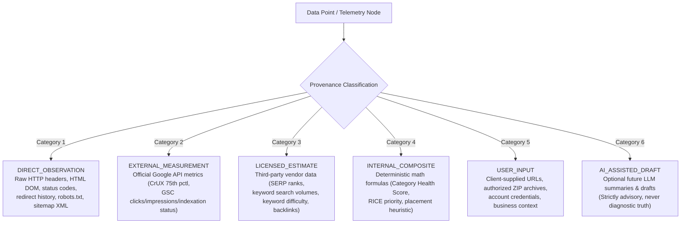
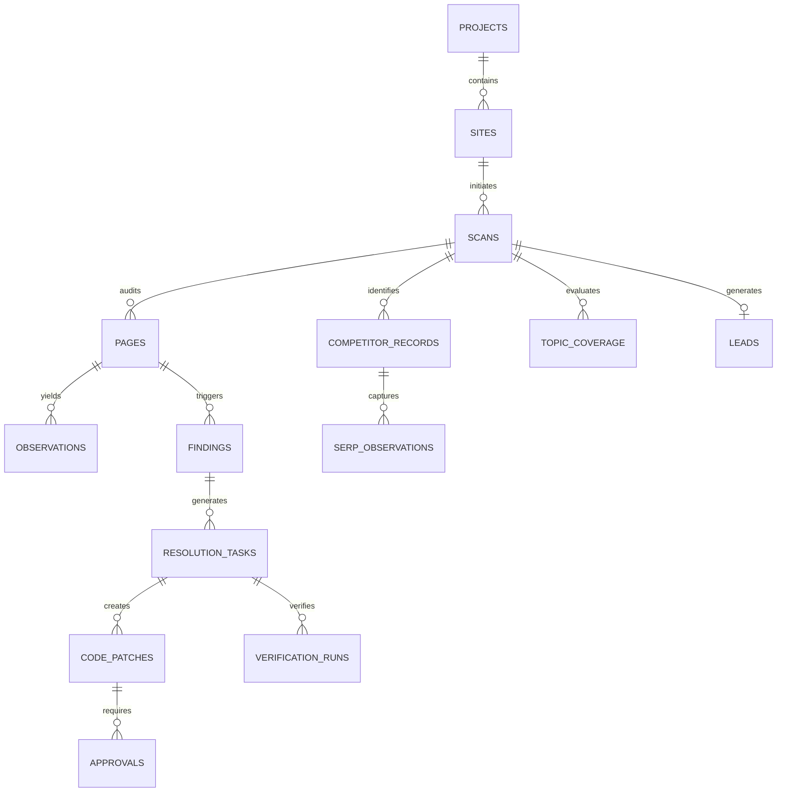

# SEO Optimizer — Data Provenance & Dictionary Specification

> **Version**: 1.0.0  
> **Status**: Approved Foundation Specification  
> **Classification**: Data Architecture, Telemetry, and Storage Governance  
> **Core Mandate**: Uncompromising data integrity and provenance. Every metric, finding, and recommendation must be traced back to its verified origin. No synthetic, fabricated, or hallucinated values.

---

## 1. Provenance Classification Taxonomy

To prevent data ambiguity and user deception, every data point ingested, computed, or displayed by SEO Optimizer is tagged with one of six canonical provenance classifications:



### 1.1 Classification Definitions

| Classification | Code | Definition & Examples | Source of Truth & Verifiability |
| :--- | :--- | :--- | :--- |
| **Direct Deterministic Observation** | `DIRECT_OBSERVATION` | Unaltered facts captured directly by the crawler or parser: HTTP status code, response headers, HTML DOM tree, `<title>`, `robots.txt` text, raw JSON-LD blocks. | 100% reproducible by re-fetching the target resource under identical network conditions. |
| **Official External Measurement** | `EXTERNAL_MEASUREMENT` | Authoritative performance or indexation telemetry provided directly by Google APIs: Chrome UX Report (CrUX) 75th percentile field metrics, Google Search Console clicks/impressions/position, URL Inspection index state. | Official Google platform data. Bound by collection windows (e.g. 28-day rolling) and API quotas. |
| **Third-Party Licensed Estimate** | `LICENSED_ESTIMATE` | Statistical models or SERP scrape data provided by compliant third-party data vendors: keyword monthly search volumes, keyword difficulty (KD), competitor SERP rankings, referring domain counts. | Vendor-modeled approximation. Must be labeled with vendor name, snapshot date, and regional market. |
| **Internal Deterministic Composite** | `INTERNAL_COMPOSITE` | Pure mathematical scores computed by our deterministic formulas: Category Health Score ($S_c$), Overall Health ($S$), Report Completeness ($C$), Content Gap ($G$), RICE Priority. | Verified by unit and property-based test suites. Computed strictly from Category 1, 2, or 3 inputs. |
| **Client / User Input** | `USER_INPUT` | Target URLs submitted for scanning, lead contact info, user-configured importance weights, uploaded ZIP source code archives. | Provided directly by authenticated or anonymous user. Subject to validation, sanitization, and quarantine. |
| **AI-Assisted Draft (Future / Optional)** | `AI_ASSISTED_DRAFT` | Natural language explanations or drafted client emails produced by LLMs in future phases. | **Never diagnostic truth**. Must be clearly badge-labeled in the UI and require explicit human review. |

---

## 2. Inviolable Data Quality Rules

1. **Missing Data Representation**:
   - When external data is not returned (e.g. site has insufficient traffic for CrUX field data, GSC API quota exceeded, or keyword volume unavailable), the field **must** be stored and presented as `NULL` / `None` / `UNKNOWN`.
   - **Zero-Fabrication Mandate**: Missing values must **never** be coerced into 0, synthetic averages, or default placeholders. An unobserved metric is unknown, not failing.
2. **Lab vs. Field Separation**:
   - Lab diagnostic metrics (e.g. Lighthouse synthetic runs in PageSpeed Insights) and Field user metrics (Chrome UX Report 75th percentile) must be stored in distinct, typed schema columns.
   - Lab data must **never** be presented as real-world user experience data, and Lighthouse Total Blocking Time (TBT) must **never** be labeled as Interaction to Next Paint (INP).
3. **SERP Censoring**:
   - If a competitor does not rank within the collected SERP depth (e.g. top 20 results), its position must be recorded as `CENSORED` / `NULL`. It must **never** be imputed as rank 100 or 101.
4. **Context Dimensions**:
   - Every external observation or estimate must store its complete contextual metadata:
     - Target Country (ISO 3166-1 alpha-2, e.g., `US`, `GB`)
     - Target City / Geo Location where localized
     - Target Language / Locale (BCP 47, e.g., `en-US`)
     - Device Class (`MOBILE` vs `DESKTOP`)
     - Retrieval Timestamp (ISO 8601 UTC)
     - Data Provider / Source Identifier

---

## 3. Relational Persistence Schema (Supabase PostgreSQL)

The persistence layer is modeled with normalized relational tables in PostgreSQL, utilizing typed `JSONB` columns for variable proof objects and raw telemetry snapshots.



### 3.1 Core Table Dictionary

#### `projects`
Organizational workspace or client account.
- `id` (`UUID`, PK): Unique project identifier.
- `name` (`VARCHAR(255)`): Project or business name.
- `created_at` (`TIMESTAMPTZ`): Record creation timestamp.
- `updated_at` (`TIMESTAMPTZ`): Last modification timestamp.

#### `sites`
A distinct domain or web property registered for monitoring.
- `id` (`UUID`, PK): Site identifier.
- `project_id` (`UUID`, FK `projects.id`): Parent project.
- `domain` (`VARCHAR(255)`): Fully qualified domain name (e.g. `example.com`).
- `scheme` (`VARCHAR(10)`): Default scheme (`https` or `http`).
- `verification_token` (`VARCHAR(64)`): Domain ownership proof token.
- `is_verified` (`BOOLEAN`): Whether ownership is verified.

#### `scans`
A discrete audit execution run against a single URL or site.
- `id` (`UUID`, PK): Unique scan identifier.
- `site_id` (`UUID`, FK `sites.id`, nullable for public scans): Associated site.
- `scan_token` (`VARCHAR(32)`, unique): Public sharing token (cryptographic nanoid).
- `target_url` (`TEXT`): User-submitted target URL.
- `canonical_url` (`TEXT`): Discovered canonical URL from final response.
- `scan_type` (`VARCHAR(32)`): `SINGLE_PAGE`, `MULTI_PAGE`, `COMPETITOR_BATCH`.
- `status` (`VARCHAR(20)`): `PENDING`, `IN_PROGRESS`, `COMPLETED`, `FAILED`.
- `failure_reason` (`TEXT`, nullable): Explicit error reason if failed.
- `overall_score` (`NUMERIC(5,2)`, nullable): Overall Health Score ($S$, $E3$).
- `category_scores` (`JSONB`): Dictionary of category scores ($S_c$, $E2$).
- `completeness_score` (`NUMERIC(5,2)`): Report Completeness ($C$, $E5$).
- `scoring_version` (`VARCHAR(32)`): Version of scoring formulas applied.
- `ruleset_version` (`VARCHAR(32)`): Version of rule evaluator applied.
- `started_at` (`TIMESTAMPTZ`): Scan start timestamp.
- `completed_at` (`TIMESTAMPTZ`, nullable): Scan completion timestamp.

#### `pages`
A specific fetched URL document within a scan.
- `id` (`UUID`, PK): Page record identifier.
- `scan_id` (`UUID`, FK `scans.id`): Associated scan.
- `url` (`TEXT`): Exact requested URL.
- `final_url` (`TEXT`): Final URL after following redirects.
- `status_code` (`INTEGER`): Final HTTP response status code.
- `response_time_ms` (`INTEGER`): End-to-end network latency.
- `content_type` (`VARCHAR(128)`): MIME type from `Content-Type` header.
- `body_byte_size` (`INTEGER`): Uncompressed body size in bytes.
- `dom_node_count` (`INTEGER`, nullable): Count of DOM nodes parsed.
- `is_spa_detected` (`BOOLEAN`): Flag indicating client-rendered SPA behavior.

#### `observations`
Raw, immutable telemetry captured during crawling and parsing.
- `id` (`UUID`, PK): Observation identifier.
- `page_id` (`UUID`, FK `pages.id`): Parent page.
- `provenance` (`VARCHAR(32)`): Provenance classification enum.
- `data_type` (`VARCHAR(64)`): `HTTP_HEADERS`, `REDIRECT_CHAIN`, `DOM_TREE`, `ROBOTS_TXT`, `SITEMAP_XML`, `JSON_LD`, `CRUX_METRICS`, `PSI_LAB`.
- `payload` (`JSONB`): Typed raw telemetry snapshot.
- `captured_at` (`TIMESTAMPTZ`): Instant of observation.

#### `findings`
Individual deterministic rule evaluations.
- `id` (`UUID`, PK): Finding identifier.
- `page_id` (`UUID`, FK `pages.id`): Parent page.
- `rule_id` (`VARCHAR(64)`): Unique rule key (e.g. `canonical-self-referential`).
- `category` (`VARCHAR(32)`): Rule category (`CRAWLABILITY`, `INDEXABILITY`, `DOCUMENT`, `CONTENT`, `STRUCTURED`, `SECURITY`).
- `state` (`VARCHAR(20)`): 5-state enum (`PASS`, `FAIL`, `UNKNOWN`, `NOT_TESTED`, `NOT_APPLICABLE`).
- `severity` (`VARCHAR(20)`): Impact severity (`CRITICAL`, `HIGH`, `MEDIUM`, `LOW`, `INFO`).
- `weight` (`INTEGER`): Rule importance weight used in score calculation ($w_i$).
- `evidence` (`JSONB`): Structured, inspectable proof object (schema detailed below).
- `remediation_guidance` (`TEXT`): Deterministic technical resolution steps.
- `created_at` (`TIMESTAMPTZ`): Finding creation timestamp.

#### `competitor_records`
Competitor domains/URLs discovered for comparative benchmarking.
- `id` (`UUID`, PK): Competitor record identifier.
- `scan_id` (`UUID`, FK `scans.id`): Originating scan.
- `competitor_domain` (`VARCHAR(255)`): Competitor domain.
- `competitor_url` (`TEXT`): Specific ranking competitor page URL.
- `visibility_score` (`NUMERIC(5,2)`, nullable): Competitor Visibility ($CV$, $E15$).
- `referring_domains` (`INTEGER`, nullable): Licensed backlink count.
- `provider` (`VARCHAR(64)`): Name of licensed data vendor.
- `retrieved_at` (`TIMESTAMPTZ`): Data retrieval timestamp.

#### `serp_observations`
Individual SERP ranking snapshots for target queries.
- `id` (`UUID`, PK): SERP observation identifier.
- `competitor_record_id` (`UUID`, FK `competitor_records.id`, nullable): Associated competitor.
- `query` (`TEXT`): Target search keyword query.
- `rank_position` (`INTEGER`, nullable): Observed SERP rank ($1–K$) or `NULL` if censored.
- `is_censored` (`BOOLEAN`): True if not found in top $K$ results.
- `country` (`VARCHAR(2)`): Search market country code (ISO 3166-1).
- `city` (`VARCHAR(64)`, nullable): Localized search city.
- `device` (`VARCHAR(10)`): `MOBILE` or `DESKTOP`.
- `provider` (`VARCHAR(64)`): Licensed SERP provider.
- `captured_at` (`TIMESTAMPTZ`): Observation timestamp.

#### `topic_coverage`
Evaluated entity and topic frequency coverage across client and competitors.
- `id` (`UUID`, PK): Topic record identifier.
- `scan_id` (`UUID`, FK `scans.id`): Associated scan.
- `topic_name` (`VARCHAR(128)`): Canonical topic or entity name.
- `target_coverage` (`NUMERIC(4,3)`): Client coverage score ($T_j \in [0.0, 1.0]$).
- `competitor_median` (`NUMERIC(4,3)`): Competitor median coverage ($C_j \in [0.0, 1.0]$).
- `coverage_gap` (`NUMERIC(4,3)`): Non-negative gap ($\max(0, C_j - T_j)$).
- `weight` (`NUMERIC(4,3)`): Topic importance weight ($w_j$).

#### `resolution_tasks`
Actionable engineering tickets in the Admin Resolution Center.
- `id` (`UUID`, PK): Task identifier.
- `finding_id` (`UUID`, FK `findings.id`): Triggering audit finding.
- `priority_score` (`NUMERIC(6,2)`): RICE-inspired priority ($P_{\text{priority}}$, $E21$).
- `triage_score` (`NUMERIC(5,2)`): Root-cause triage composite ($RC$, $E20$).
- `target_selector` (`TEXT`, nullable): Exact DOM selector or insertion path.
- `target_file_path` (`TEXT`, nullable): Source code file path (Phase 5 only).
- `status` (`VARCHAR(32)`): `PENDING_REVIEW`, `APPROVED`, `REJECTED`, `IN_PROGRESS`, `DEPLOYED`, `VERIFIED`.
- `assigned_to` (`UUID`, nullable): Engineer user ID.

#### `code_patches`
Unified diffs generated for source code remediation.
- `id` (`UUID`, PK): Patch identifier.
- `resolution_task_id` (`UUID`, FK `resolution_tasks.id`): Associated task.
- `diff_content` (`TEXT`): Git unified diff format string.
- `affected_file` (`TEXT`): Target file path within archive.
- `patch_hash` (`VARCHAR(64)`): SHA-256 hash of the diff payload.
- `created_at` (`TIMESTAMPTZ`): Generation timestamp.

#### `approvals`
Audit trail of human authorization gates.
- `id` (`UUID`, PK): Approval identifier.
- `code_patch_id` (`UUID`, FK `code_patches.id`): Target patch.
- `approver_id` (`UUID`): Approving engineer or client user ID.
- `approval_type` (`VARCHAR(32)`): `ADMIN_ENGINEER`, `CLIENT_AUTHORIZED`.
- `status` (`VARCHAR(20)`): `APPROVED`, `REJECTED`.
- `notes` (`TEXT`, nullable): Justification or feedback notes.
- `decided_at` (`TIMESTAMPTZ`): Decision timestamp.

#### `verification_runs`
Post-deployment automated checks verifying issue resolution.
- `id` (`UUID`, PK): Verification run identifier.
- `resolution_task_id` (`UUID`, FK `resolution_tasks.id`): Verified task.
- `post_scan_id` (`UUID`, FK `scans.id`): Post-remediation scan record.
- `previous_state` (`VARCHAR(20)`): Must be `FAIL`.
- `current_state` (`VARCHAR(20)`): Outcome of re-scan (`PASS`, `FAIL`, etc.).
- `is_resolved` (`BOOLEAN`): True if `current_state == PASS`.
- `verified_at` (`TIMESTAMPTZ`): Verification timestamp.

#### `leads`
Prospects captured from public scan reports.
- `id` (`UUID`, PK): Lead identifier.
- `scan_id` (`UUID`, FK `scans.id`): Linked scan.
- `email` (`VARCHAR(255)`): Business email address.
- `domain` (`VARCHAR(255)`): Associated domain.
- `tech_stack` (`JSONB`): Detected frameworks and CMS platforms.
- `status` (`VARCHAR(32)`): `NEW`, `CONTACTED`, `QUALIFIED`, `CONVERTED`, `UNQUALIFIED`.
- `created_at` (`TIMESTAMPTZ`): Submission timestamp.

---

## 4. Structured Evidence JSONB Schema

Every finding recorded in the `findings` table contains an immutable, typed `evidence` object conforming to the following Pydantic / TypeScript schema:

```json
{
  "$schema": "https://json-schema.org/draft/2020-12/schema",
  "title": "FindingEvidence",
  "type": "object",
  "properties": {
    "targetElement": {
      "type": "string",
      "description": "CSS selector or DOM hierarchy path (e.g. 'head > link[rel=\"canonical\"]')"
    },
    "observedValue": {
      "type": ["string", "null"],
      "description": "Exact observed value from the crawl or DOM (e.g. 'http://example.com/page')"
    },
    "expectedValue": {
      "type": ["string", "null"],
      "description": "Standard compliance requirement (e.g. 'https://example.com/page')"
    },
    "rawSnippet": {
      "type": ["string", "null"],
      "description": "Exact verbatim HTML tag or response header snippet (e.g. '<link rel=\"canonical\" href=\"http://example.com/page\">')"
    },
    "httpStatusCode": {
      "type": ["integer", "null"],
      "description": "Relevant HTTP response status code"
    },
    "responseTimeMs": {
      "type": ["integer", "null"],
      "description": "Round-trip network timing in milliseconds"
    },
    "lineNumber": {
      "type": ["integer", "null"],
      "description": "Line number in the raw HTML payload where the element begins"
    },
    "provenance": {
      "type": "string",
      "enum": ["DIRECT_OBSERVATION", "EXTERNAL_MEASUREMENT", "LICENSED_ESTIMATE", "INTERNAL_COMPOSITE", "USER_INPUT", "AI_ASSISTED_DRAFT"],
      "description": "Provenance category classification"
    },
    "contextData": {
      "type": "object",
      "additionalProperties": true,
      "description": "Additional structured evidence (e.g. parsed JSON-LD AST, redirect hop array)"
    }
  },
  "required": ["observedValue", "expectedValue", "provenance"]
}
```

---

## 5. Security & Encryption of Credentials

1. **OAuth 2.0 Credentials (Search Console)**:
   - Google Search Console OAuth tokens (`access_token`, `refresh_token`) must be encrypted at rest in the database using **AES-256-GCM**.
   - Cryptographic keys are managed strictly via environment configuration (`GSC_ENCRYPTION_KEY`) and must never be committed to source code or logged.
   - Decryption occurs strictly server-side within the Python backend immediately prior to dispatching authenticated Google API requests.
   - **Zero Client Exposure**: Decrypted tokens, refresh tokens, and client secrets must **never** be transmitted to the frontend web application or logged in telemetry.
2. **Row-Level Security (RLS)**:
   - Supabase PostgreSQL Row-Level Security policies are active on all tables.
   - Anonymous users have read-only access to `scans` and `findings` only when possessing the matching cryptographic `scan_token`.
   - Admin tables (`resolution_tasks`, `code_patches`, `approvals`, `leads`) require authenticated JWT tokens with `admin` or `engineer` role claims.

