# SEO Optimizer — Product & Project Brief

> **Version**: 2.0.0 (Foundation Alignment)  
> **Status**: Approved Project Foundation  
> **Technology Stack**: Python (FastAPI) Backend | Next.js (TypeScript) Frontend | Supabase PostgreSQL  
> **Core Architecture**: Deterministic, Evidence-Based, Zero-Hallucination

---

## 1. Executive Summary

**SEO Optimizer** is an evidence-based Technical SEO Diagnosis, Competitor Intelligence, and Website Code Resolution Platform backed by a service-led lead-generation funnel.

Unlike traditional SEO tools that output arbitrary, opaque scores, black-box recommendations, or probabilistic AI-generated advice, SEO Optimizer is engineered upon a strict **zero-hallucination, evidence-backed mathematical architecture**. Every identified issue is tied directly to verifiable technical proof (exact raw HTTP response headers, DOM selectors, parsed JSON-LD payloads, status code timelines, and line numbers).

Furthermore, SEO Optimizer bridges the long-standing industry gap between **diagnosis** and **remediation**: it not only diagnoses root technical bottlenecks and calculates mathematical competitor gaps, but provides an evidence-backed resolution plan with exact implementation locations, facilitates human-authorized source-code modifications, and verifies changes post-deployment.

---

## 2. Product Vision & Mission

### Vision
To be the most reliable, deterministic, and verifiable technical SEO platform in the world—empowering businesses, engineers, and agencies to diagnose search engine bottlenecks with scientific precision, benchmark against competitors, and deploy verified code fixes with complete confidence.

### Mission
Eliminate guesswork, misinformation, and false promises in technical SEO by providing:
1. **Mathematical, deterministic auditing** with 100% reproducible evidence and pure functions.
2. **Transparent, rule-based scoring** that never confuses internal technical compliance with secret search-engine ranking algorithms.
3. **Actionable engineering pathways** that transform raw SEO findings into exact DOM triggers, runbooks, and human-authorized source-code patches.
4. **Verifiable before-and-after resolution proof** ensuring every attempted remediation is re-scanned and validated.

---

## 3. Core Architectural Principles & Inviolable Rules

1. **Deterministic & Rule-Based Core**:
   All issue detection, severity rating, category scoring, competitor gap calculations, prioritization, and verification metrics MUST be pure deterministic functions. **No Machine Learning (ML) or Large Language Models (LLMs)** are permitted in diagnostic or mathematical evaluation engines. AI may be introduced later only as an optional explanation or drafting assistant, never as the source of truth.
2. **Verifiable Proof Required**:
   Every diagnostic finding MUST include immutable, inspectable evidence (exact observed value, expected value, raw HTML/header snippet, and DOM selector). If a canonical tag is flagged as broken, the report must display the verbatim tag, its container location, and the network response of the target URL.
3. **5-State Audit Rule Outcomes**:
   Every audit check evaluates to one of five unambiguous states:
   - `PASS`: Verified condition satisfied with evidence ($q_i = 1.0$).
   - `FAIL`: Verified condition not satisfied with evidence ($q_i = 0.0$).
   - `UNKNOWN`: Attempted but insufficient evidence/data (e.g., target host timed out, partial network failure).
   - `NOT_TESTED`: Check not attempted due to scope or operational constraints.
   - `NOT_APPLICABLE`: Rule does not apply to the given resource (e.g., AMP checks on non-AMP pages).
   *Unknown, not-tested, and not-applicable must never be silently mapped to zero or one.*
4. **Strict Boundaries on Promises ("Never Promise")**:
   The platform and its reports will **NEVER promise or imply**:
   - Google Page 1 ranking or any specific ranking position.
   - A fixed organic traffic increase or revenue uplift.
   - Indexing within a fixed timeframe.
   - That an internal technical SEO score predicts or correlates with Google's proprietary search ranking algorithm.
5. **No Data Fabrication**:
   The system will **NEVER invent or fabricate** keyword search volumes, keyword difficulty scores, competitor backlink counts, Google Search Console metrics, or real-world Core Web Vitals field data. If required data is unavailable, it is explicitly returned as `NULL` / `UNKNOWN`.
6. **Separation of Health vs. Ranking**:
   Our internal **Technical SEO Health Score (0–100)** measures technical standards compliance (W3C, Schema.org, RFCs, Google Search Central technical guidelines). It is strictly decoupled from Google's proprietary search ranking signals.
7. **Scope Distinction (URL-Only Scan vs. Full-Domain Audit)**:
   A URL-only scan audits the submitted page plus explicitly defined root-level resources (such as `/robots.txt` and sitemap discovery). It must **never** be marketed or presented as a full-domain audit unless a separate domain crawler has crawled a documented set of pages.
8. **Zero Host Execution of Client Code**:
   Client-uploaded source code archives (ZIP files) must **NEVER** be compiled, bundled, or executed on the main API host. All code analysis is static (AST inspection). Build/test verification occurs in ephemeral, unprivileged micro-sandboxes with default-deny network egress.
9. **Mandatory Human Approval Gates**:
   No code patch, file modification, production deployment, or paid third-party API call may ever be triggered automatically without explicit, auditable human confirmation.
10. **Zero-Trust Public Scanning (SSRF Immunity)**:
    The public scanner enforces comprehensive SSRF prevention: protocol restrictions, port whitelisting, comprehensive CIDR denylists, DNS pre-resolution with socket pinning (preventing DNS rebinding / TOCTOU), manual hop-by-hop redirect validation, and strict streaming byte/time limits.

---

## 4. End-to-End Core Workflow

The platform executes an 11-stage closed-loop technical workflow:

```mermaid
flowchart LR
    Diagnose["1. Diagnose\n(Page Scan)"] --> Collect["2. Collect Data\n(Headers & DOM)"]
    Collect --> Competitor["3. Discover Competitors\n(SERP Analysis)"]
    Competitor --> Compare["4. Compare\n(Benchmarking)"]
    Compare --> Gaps["5. Calculate Gaps\n(Content/KW/Authority)"]
    Gaps --> Plan["6. Plan Resolution\n(Runbooks & Priorities)"]
    Plan --> Approve["7. Approve\n(Human Gate)"]
    Approve --> Modify["8. Modify\n(Static AST Patch)"]
    Modify --> Test["9. Test\n(Sandboxed Build/QA)"]
    Test --> Deploy["10. Deploy\n(Client-Authorized)"]
    Deploy --> Verify["11. Verify & Monitor\n(DiD & Regression)"]
```



1. **Diagnose**: Public scanner ingests target URL with zero-trust network controls.
2. **Collect Data**: Captures raw HTTP status, headers, HTML DOM, `robots.txt`, and XML sitemaps.
3. **Discover Competitors**: Identifies true organic competitors for target queries via compliant licensed SERP data.
4. **Compare**: Fetches public competitor pages and computes deterministic structural benchmarks.
5. **Calculate Gaps**: Computes mathematical Content Gap ($E16$), Keyword Opportunity ($E17$), and Referring Domain Gap ($E22$).
6. **Plan Resolution**: Admin Resolution Center groups findings, assigns RICE Priority ($E21$), and establishes DOM placement triggers ($E19$).
7. **Approve**: Client and technical SEO engineer review and explicitly approve proposed remediation runbooks.
8. **Modify**: Static AST engines generate precise Git unified diffs (`.patch`) for verified issues.
9. **Test**: Ephemeral sandboxes verify that code builds cleanly with zero regressions.
10. **Deploy**: Client applies the verified patch to their production repository.
11. **Verify & Monitor**: System re-scans the live URL, calculates Issue Resolution Rate ($E33$), Regression Rate ($E35$), and monitors GSC performance trends ($E24$–$E28$) and Difference-in-Differences ($E36$).

---

## 5. Business Model & Funnel Strategy

SEO Optimizer operates a 4-tier progressive revenue model designed to capture immediate top-of-funnel demand while building high-ticket service engagements and long-term recurring revenue:

```
+-----------------------------------------------------------------------+
| 1. Free Public Page-Level SEO Scan                                    |
|    - Instant URL scan with verifiable proof and 5-state findings      |
|    - Clear technical blockers separated from minor opportunities      |
+-----------------------------------+-----------------------------------+
                                    | Qualified Lead Capture
                                    v
+-----------------------------------------------------------------------+
| 2. Qualified Lead Generation Engine                                   |
|    - Verified domain ownership, business email, and tech stack        |
|    - Quantified technical blocker impact and competitor visibility    |
+-----------------------------------+-----------------------------------+
                                    | Service Inquiry
                                    v
+-----------------------------------------------------------------------+
| 3. Professional Scoped 15-Day Technical SEO Service                   |
|    - Done-for-you technical engineering engagement                    |
|    - Source-code patch generation via Admin Resolution Center         |
|    - Sandboxed build/test verification and client patch delivery      |
+-----------------------------------+-----------------------------------+
                                    | Expansion / Retention
                                    v
+-----------------------------------------------------------------------+
| 4. Self-Service SaaS & Agency Platform (Later Phase)                  |
|    - Continuous site-wide monitoring & scheduled regression scans     |
|    - Google Search Console performance decline tracking & alerts      |
|    - Multi-tenant client management for agencies                      |
+-----------------------------------------------------------------------+
```

---

## 6. Target Personas

| Persona | Primary Goal | Pain Point with Existing Tools | SEO Optimizer Solution |
| :--- | :--- | :--- | :--- |
| **SMB & Business Owner** | Improve website discoverability without paying for confusing retainers. | Tools output 200 vague warnings and arbitrary scores with no clear path to fix them. | Clear, prioritized checklist separating critical blockers from minor suggestions, backed by professional 15-day resolution. |
| **Agency SEO Specialist** | Deliver technical audits and implementation roadmaps to clients quickly. | Audits take 20+ hours of manual spreadsheet work; developers ignore vague recommendations. | Automated deterministic evidence gathering with exact DOM selectors, competitor gaps, and runbooks. |
| **Full-Stack Developer** | Resolve SEO tickets without guessing what SEO consultants actually want. | Vague tickets ("make it more SEO friendly") with no technical specifications or code locations. | Exact technical requirements: raw headers, canonical logic, DOM selectors, JSON-LD schemas, and git patch diffs. |

---

## 7. Product Phasing & Scope Boundaries

### Phase 0: Foundation Alignment (Current Milestone)
- Architecture alignment: Python (FastAPI) backend, Next.js (TypeScript) frontend.
- Creation of Mathematical Model Catalogue (`docs/MATHEMATICAL_MODEL_CATALOG.md`) covering models $E1$ through $E36$.
- Creation of Data Provenance & Dictionary (`docs/DATA_PROVENANCE_AND_DICTIONARY.md`).
- Updating Architecture Decisions (ADRs), Security Requirements, and Project Brief.
- Zero dependency installation, zero migrations, zero paid APIs in Phase 0.

### Phase 1: Public Deterministic Page Scanner
- Single public URL page-level technical SEO scanner.
- Python FastAPI backend with Pydantic v2 domain contracts.
- Secure HTTP crawler with socket pinning, manual redirect validation, and SSRF guard.
- Static HTML DOM parser using BeautifulSoup 4 and lxml.
- Deterministic 5-state rules engine and evidence generator.
- Category Weighted SEO Health Score ($E2$), Overall SEO Health Score ($E3$), Legacy Deduction Model ($E4$, calibration), and Report Completeness ($E5$).
- Link and Asset metrics: Broken Internal Link Ratio ($E8$), Internal Link Health ($E9$), Image Alt Coverage ($E10$), Redirect Hop Count ($E11$), Sitemap URL Health ($E12$), JSON-LD Syntax Validity Ratio ($E14$).
- SPA static rendering limitation honestly reported: static scan reports `SPA_DETECTED`; affected DOM rules return `UNKNOWN` or `NOT_TESTED`.
- Public responsive Next.js web application with interactive evidence drawers.

### Phase 2: Performance, Persistence & Lead Management
- Google PageSpeed Insights API integration (Core Web Vitals: LCP, INP, CLS via $E6$, normalization via $E7$).
- Strict separation of CrUX field 75th percentile and Lighthouse lab diagnostics.
- Supabase PostgreSQL persistence for scans, findings, observations, and leads.
- Alembic database migrations and Row-Level Security (RLS) policies.
- Lead capture engine and operational metrics: Scan Completion Rate ($E29$), Lead Conversion Rate ($E30$), Qualified Lead Rate ($E31$), Client Conversion Rate ($E32$).

### Phase 3: Competitor & Data Intelligence
- Compliant licensed SERP data provider integration.
- Query-, country-, and device-specific competitor discovery.
- Conservative competitor page crawler with strict rate limits.
- Competitor Visibility Score ($E15$), Weighted Content Coverage Gap ($E16$), Keyword Opportunity Score ($E17$), Potential Click Opportunity ($E18$).
- Referring Domain Gap ($E22$) and Link Opportunity Relevance ($E23$) when a licensed backlink provider is configured.

### Phase 4: Mathematical Resolution Center
- Administrative workspace for technical SEO engineers.
- Content Section Placement Score ($E19$) with exact DOM trigger paths.
- Root-Cause Triage Composite ($E20$) as a task triage indicator (not a causal probability).
- Resolution Priority ($E21$) using RICE-inspired deterministic ordering.
- Standardized 15-day implementation proposal generation with step-by-step procedures.

### Phase 5: Secure Code Remediation & Patching
- Secure client ZIP upload with quarantine storage, Zip Slip protection, and Zip Bomb defenses.
- Static AST inspection of supported frameworks (Next.js, static HTML) without executing client code.
- Git unified diff generation (`.patch`).
- Ephemeral, unprivileged microVM/sandbox build and test verification.
- Mandatory human approval gate prior to client patch delivery.

### Phase 6: Search Console & Outcome Analytics
- OAuth 2.0 Google Search Console API integration with AES-256-GCM token encryption at rest.
- Search Analytics query analysis with quotas, backoff, and caching.
- URL Inspection API integration for sampled indexation rate ($E13$).
- Search Console metrics: CTR ($E24$), Impression Decline ($E25$), Click Decline ($E26$), Average Position Change ($E27$), Keyword Cannibalization Signal ($E28$).
- Outcome verification: Issue Resolution Rate ($E33$), Metric Performance Improvement ($E34$), Audit Regression Rate ($E35$), and Difference-in-Differences ($E36$).

---

## 8. Success Criteria & KPIs

- **Diagnostic Accuracy**: 100% test pass rate on deterministic synthetic fixture pages covering valid, invalid, and edge-case technical SEO configurations.
- **Scan Latency**: Average public single-page scan execution time under 4.0 seconds for static page analysis.
- **Security Compliance**: Zero SSRF vulnerabilities, zero internal network leakage, 100% blocking of loopback, private CIDR, and cloud metadata requests.
- **Evidence Completeness**: 100% of reported findings contain a structured, inspectable proof object.
- **Audit Reproducibility**: Running the scan multiple times against an unchanged target page produces identical findings and scores.
- **Formula Coverage**: 100% of mathematical models $E1$ through $E36$ have documented implementation ownership, versioning, and test suites.
